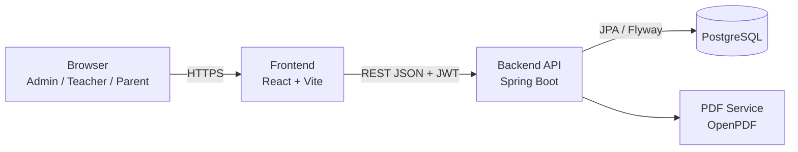
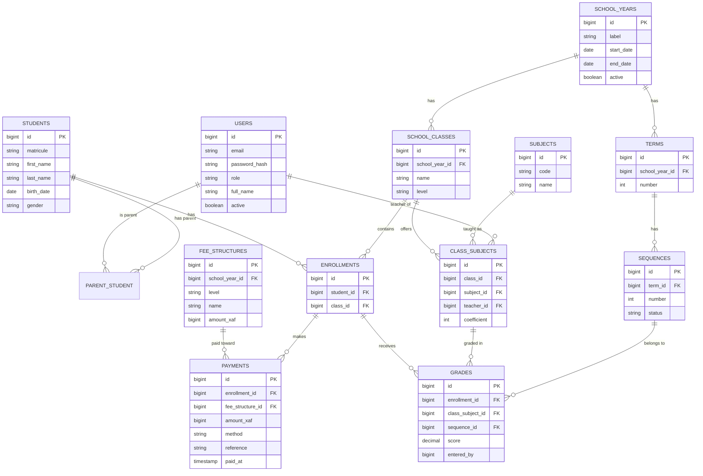

# Architecture

> High-level overview of the project structure, tech stack and how everything connects.

## 01 System Overview



The frontend is a static single-page app. The backend is a stateless REST API. All state lives in PostgreSQL.

## 02 Tech Stack

| Area | Technology | Notes |
|---|---|---|
| Backend | Java 21, Spring Boot 3, Maven | Layered architecture by module |
| Security | Spring Security, JWT (jjwt) | Access 15 min, refresh 7 days |
| Persistence | Spring Data JPA, Hibernate, Flyway | Versioned migrations |
| Mapping | MapStruct, Lombok | DTO mapping, less boilerplate |
| API docs | springdoc-openapi | Swagger UI at `/swagger-ui.html` |
| PDF | OpenPDF | Report cards |
| Frontend | React 18, Vite, TypeScript | Strict mode |
| UI | Tailwind CSS, shadcn/ui, Lucide | See DESIGN_SYSTEM.md |
| Data fetching | TanStack Query, Axios | Caching and retries |
| Forms | React Hook Form, Zod | Shared validation rules |
| Testing | JUnit 5, Mockito, Testcontainers, Vitest | See TESTING.md |
| DevOps | Docker, GitHub Actions, Render | CI on every push |

## 03 Project Structure

```
School-Management/
├── backend/
│   ├── pom.xml
│   └── src/main/java/com/schoolmanagement/
│       ├── auth/         # login, JWT, users, roles
│       ├── academic/     # school years, terms, sequences, classes, subjects
│       ├── student/      # students, parents, enrollments
│       ├── grading/      # grades, averages, ranking, report cards, PDF
│       ├── fees/         # fee structures, payments, balances
│       ├── audit/        # audit log
│       └── common/       # config, exceptions, pagination, utils
│   └── src/main/resources/db/migration/   # Flyway: V1__init.sql ...
├── frontend/
│   └── src/
│       ├── app/          # routing, providers
│       ├── components/   # ui/ (shadcn) and shared components
│       ├── features/     # auth, classes, grades, fees, students
│       ├── lib/          # api client, utils
│       └── types/        # API types
├── docs/
├── docker-compose.yml
└── render.yaml
```

Each backend module contains: `controller`, `service`, `repository`, `entity`, `dto`, `mapper`.

## 04 Data Model



Constraints worth remembering:
- `grades`: unique (`enrollment_id`, `class_subject_id`, `sequence_id`), score between 0 and 20.
- `enrollments`: one enrollment per student per school year.
- `class_subjects`: unique (`class_id`, `subject_id`).
- An `audit_log` table records grade edits and payments (who, what, when, old and new value).

## 05 Data Flow (example: entering a grade)

1. The teacher submits a grade in the grid (React Hook Form + Zod validation).
2. The frontend sends `POST /api/v1/grades` with the JWT.
3. Spring Security validates the token and role (`TEACHER`).
4. `GradeService` checks the teacher is assigned to that class and subject, and that the sequence is open.
5. The grade is saved and an audit record is written in the same transaction.
6. The API returns the saved grade as a DTO; TanStack Query refreshes the grid and averages.

## 06 Grade Calculation

Implemented in a pure, framework-free class (`AverageCalculator`) so it is trivially unit-testable.
- Sequence average = sum(score x coefficient) / sum(coefficients of graded subjects)
- Term average = mean of its two sequence averages
- Rank = position by term average, ties share the same rank
- Rounding: `HALF_UP` to 2 decimals, applied only at the end

## 07 Deployment

| Component | Target |
|---|---|
| API | Render Web Service (Docker) |
| Frontend | Render Static Site |
| Database | Render PostgreSQL (free plans have limits, check current Render policy) |

`render.yaml` describes all three. Secrets are set in the Render dashboard. CI (GitHub Actions) builds and tests on every push and pull request; deployment triggers from `main`.

Configuration through environment variables: `DATABASE_URL`, `DB_USER`, `DB_PASSWORD`, `JWT_SECRET`, `CORS_ALLOWED_ORIGINS`, `VITE_API_URL`.

## 08 Architecture Decisions

| Decision | Reason |
|---|---|
| Modular monolith | Simple to build and deploy, modules can be split later |
| Monorepo | One repo to show, one CI, docs in one place |
| Flyway over `ddl-auto` | Reproducible schema, safe evolution |
| DTOs everywhere | Entities never leak, API stays stable |
| Money as integer XAF | XAF has no decimals, avoids floating point errors |
| Stateless JWT | Easy horizontal scaling |

## 09 Scalability and Future Considerations

- Add caching (Spring Cache) for report card computations.
- Generate bulk PDFs asynchronously for large classes.
- Introduce a `school_id` column for multi-tenant support.
- Expose grades as a dataset for the future ML module (at-risk student detection).
- Add a notification module (SMS / WhatsApp) behind an interface.
